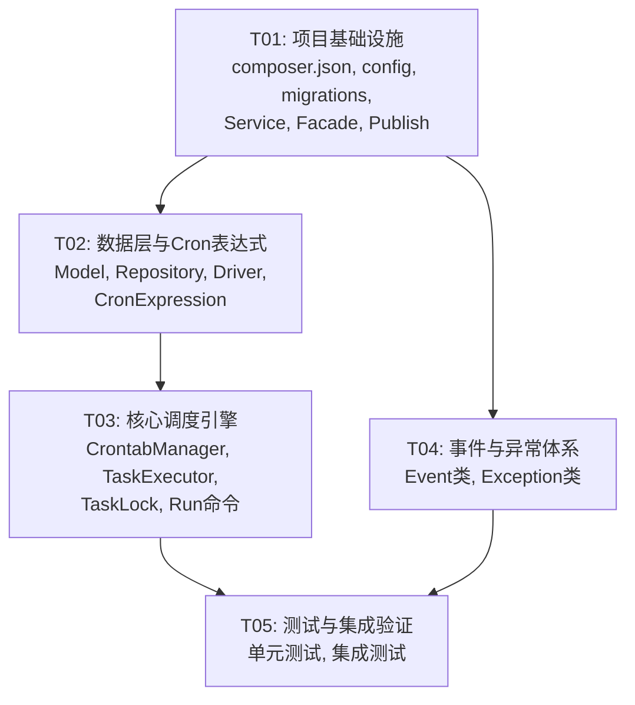

# wiseadmin/wise-crontab 系统架构设计

> **版本**: v1.0  
> **设计者**: Bob (Architect)  
> **日期**: 2025-01-20  
> **目标**: 为 ThinkPHP 8 提供底层定时任务调度能力，后续 UI 插件在此基础上开发

---

## Part A: 系统设计

### 1. 实现方案概述

#### 1.1 核心设计思路

`wiseadmin/wise-crontab` 是一个纯底层定时任务调度引擎，**不包含**任何 UI/HTTP 接口。它提供：

- **调度表达式解析**：自研 `CronExpression`（5 段语法 + `L`/`W`/`#`）与 `Schedule`（中英双语语义化），零第三方依赖
- **双源任务注册**：配置文件静态注册 + 数据库动态注册，数据库优先
- **每分钟轮询调度**：通过 `php think wscrontab:run` 供系统 crontab `* * * * *` 调用
- **进程隔离执行**：每个任务通过 `Symfony\Process` 在独立子进程中执行
- **文件锁防并发**：基于 `flock()` 的文件锁防止同一任务重复执行
- **完整执行日志**：记录每次执行的耗时、输出、退出码、状态
- **事件驱动扩展**：BeforeTaskExecute / AfterTaskExecute / TaskExecuteFailed 三个事件钩子

#### 1.2 技术选型

| 技术点 | 选型 | 理由 |
|--------|------|------|
| 调度表达式解析 | 自研 `CronExpression` + `Schedule` | 实际只用到 4 个方法，自研可去掉第三方依赖；同时提供中英双语语义化写法 |
| 进程隔离 | `symfony/process` | ThinkPHP 框架已依赖，API 稳定，跨平台 |
| 数据库 ORM | `topthink/think-orm` | ThinkPHP 8 原生 ORM，composer.json 已声明依赖 |
| 文件锁 | PHP 原生 `flock()` | 零依赖，可靠，支持非阻塞模式 |
| 事件系统 | `think\facade\Event` | ThinkPHP 原生事件，与现有包保持一致 |
| 日志 | `think\facade\Log` | ThinkPHP 原生日志，支持通道隔离 |

#### 1.3 架构模式

采用 **Manager + Repository + Driver** 三层模式（与 wise-backup 完全一致）：

```
Facade (门面)
  └── CrontabManager (核心编排器)
        ├── TaskRepositoryInterface (任务存储抽象)
        │     ├── ConfigTaskRepository (配置文件读取)
        │     └── DatabaseTaskRepository (数据库读取)
        ├── CronExpression (Cron 表达式解析)
        ├── TaskExecutor (任务进程执行)
        └── TaskLock (防并发锁)
```

#### 1.4 扩展点设计（预留给 UI 插件）

1. **TaskRepositoryInterface**：UI 插件通过实现此接口可新增其他存储源（如 Redis）
2. **DatabaseTaskRepository**：UI 插件直接操作 `crontab_task` 表进行动态管理
3. **Event 事件钩子**：UI 插件监听三个事件实现通知/告警/回调
4. **CrontabManager::dispatch()** 返回值：包含完整的调度统计，便于 UI 插件查询

---

### 2. 完整文件列表

所有路径相对于 `src/packages/wiseadmin/wise-crontab/`：

```
wise-crontab/
├── composer.json
├── phpunit.xml
├── config/
│   └── wisecrontab.php                      # 默认配置
├── database/
│   └── migrations/
│       ├── 20250101000001_create_crontab_task.php      # 任务表
│       └── 20250101000002_create_crontab_task_log.php  # 日志表
├── src/
│   ├── Service.php                          # 服务注册（ extends \think\Service ）
│   ├── Facade.php                           # 门面（ extends \think\Facade ）
│   ├── CrontabManager.php                   # 核心调度管理器
│   ├── TaskRepositoryInterface.php          # 任务存储接口
│   ├── CronExpression.php                   # Cron 表达式封装
│   ├── TaskExecutor.php                     # 任务进程执行器
│   ├── TaskLock.php                         # 防并发锁
│   ├── command/
│   │   └── Run.php                          # 调度运行命令（ wscrontab:run ）
│   ├── driver/
│   │   ├── ConfigTaskRepository.php         # 配置文件任务存储
│   │   └── DatabaseTaskRepository.php       # 数据库任务存储
│   ├── event/
│   │   ├── BeforeTaskExecute.php            # 任务执行前事件
│   │   ├── AfterTaskExecute.php             # 任务执行后事件
│   │   └── TaskExecuteFailed.php            # 任务执行失败事件
│   ├── exception/
│   │   ├── CrontabException.php             # 通用异常
│   │   └── TaskLockException.php            # 锁异常
│   └── model/
│       ├── TaskModel.php                    # 任务数据模型
│       └── TaskLogModel.php                 # 任务日志模型
├── tests/
│   ├── bootstrap.php                        # 测试引导
│   ├── TestCase.php                         # 测试基类
│   ├── CronExpressionTest.php               # Cron 表达式测试
│   ├── CrontabManagerTest.php               # 调度管理器测试
│   └── TaskExecutorTest.php                 # 执行器测试
```

---

### 3. 数据结构与接口

#### 3.1 数据库表结构

**表 `crontab_task`（任务定义表）**

| 字段 | 类型 | 说明 |
|------|------|------|
| id | INT UNSIGNED AUTO_INCREMENT PK | 主键 |
| name | VARCHAR(100) NOT NULL UNIQUE | 任务标识名（如 `backup_daily`） |
| title | VARCHAR(200) NOT NULL | 任务显示名称 |
| description | VARCHAR(500) DEFAULT '' | 任务描述 |
| command | VARCHAR(500) NOT NULL | 执行命令（如 `php think wise:backup:run`） |
| cron_expression | VARCHAR(100) NOT NULL | Cron 表达式（如 `0 2 * * *`） |
| status | TINYINT(1) NOT NULL DEFAULT 1 | 状态：1=启用 0=禁用 |
| timeout | INT UNSIGNED NOT NULL DEFAULT 300 | 超时时间（秒） |
| max_retries | TINYINT UNSIGNED NOT NULL DEFAULT 0 | 最大重试次数 |
| allow_concurrent | TINYINT(1) NOT NULL DEFAULT 0 | 是否允许并发：1=允许 0=禁止 |
| source | VARCHAR(20) NOT NULL DEFAULT 'database' | 来源：`config` 或 `database` |
| create_time | DATETIME | 创建时间 |
| update_time | DATETIME | 更新时间 |

**索引**: `UNIQUE(name)`, `INDEX(status)`

**表 `crontab_task_log`（任务执行日志表）**

| 字段 | 类型 | 说明 |
|------|------|------|
| id | BIGINT UNSIGNED AUTO_INCREMENT PK | 主键 |
| task_id | INT UNSIGNED NOT NULL | 关联任务 ID（config 源任务为 0） |
| task_name | VARCHAR(100) NOT NULL | 任务标识名（冗余，便于查询） |
| status | VARCHAR(20) NOT NULL DEFAULT 'running' | 执行状态：`running`/`success`/`failure` |
| output | MEDIUMTEXT | 标准输出内容（截断至 64KB） |
| error_output | MEDIUMTEXT | 错误输出内容（截断至 64KB） |
| exit_code | INT DEFAULT NULL | 进程退出码 |
| start_time | DATETIME NOT NULL | 执行开始时间 |
| end_time | DATETIME DEFAULT NULL | 执行结束时间 |
| duration | DECIMAL(10,4) DEFAULT NULL | 耗时（秒，精确到毫秒） |
| retry_count | TINYINT UNSIGNED NOT NULL DEFAULT 0 | 当前重试次数 |
| process_id | INT UNSIGNED DEFAULT NULL | 执行进程 PID |
| create_time | DATETIME | 创建时间 |

**索引**: `INDEX(task_id)`, `INDEX(task_name)`, `INDEX(status)`, `INDEX(create_time)`

#### 3.2 配置结构（`config/wisecrontab.php`）

```php
<?php
return [
    // ========== 静态任务定义 ==========
    'tasks' => [
        // [
        //     'name'             => 'demo_task',
        //     'title'            => '示例任务',
        //     'description'      => '这是一个示例定时任务',
        //     'command'          => 'php think demo:run',
        //     'cron_expression'  => '*/5 * * * *',
        //     'status'           => 1,
        //     'timeout'          => 300,
        //     'max_retries'      => 0,
        //     'allow_concurrent' => false,
        // ],
    ],

    // ========== 数据库表名 ==========
    'table_task'     => 'crontab_task',
    'table_task_log' => 'crontab_task_log',

    // ========== 默认参数 ==========
    'default_timeout'   => 300,   // 默认超时（秒）
    'default_max_retries' => 0,   // 默认最大重试次数

    // ========== 日志保留策略 ==========
    'log_retention_days' => 30,   // 日志保留天数，0=永久

    // ========== 锁配置 ==========
    'lock_dir'    => '',          // 锁文件目录，空=使用 runtime_path().'crontab/lock'
    'lock_ttl'    => 3600,        // 锁最大持有时间（秒），超时自动释放

    // ========== 输出截断 ==========
    'output_max_bytes' => 65536,  // 单次输出最大存储字节（64KB）
];
```

#### 3.3 核心类图（Mermaid classDiagram）

> 详见 `docs/class-diagram.mermaid`

#### 3.4 关键接口与类说明

**TaskRepositoryInterface** — 任务存储统一接口：
```php
interface TaskRepositoryInterface
{
    /** @return array<int, array> 返回任务数据数组 */
    public function all(): array;
    /** @return array|null 根据名称获取单个任务 */
    public function findByName(string $name): ?array;
    /** 检查存储源是否可用 */
    public function isAvailable(): bool;
}
```

**CronExpression** — 自研 Cron 表达式解析器（5 段语法，支持 `*` `,` `-` `/` `?`、`L`/`W`/`#`、`JAN`-`DEC`/`MON`-`SUN` 与 `@daily` 等别名）：
```php
class CronExpression
{
    public function __construct(string $expression);                  // 非法表达式抛 InvalidArgumentException
    public function isDue(string $time = 'now'): bool;
    public function getNextRunDate(string $time = 'now', int $nth = 0, bool $allowCurrentDate = false): \DateTime;
    public function getPreviousRunDate(string $time = 'now', int $nth = 0, bool $allowCurrentDate = false): \DateTime;
    public function getExpression(): string;                          // 归一化后的 5 段表达式
    public static function isValid(string $expression): bool;
}
```

**Schedule** — 语义化调度解析（中英双语，`CrontabManager` 在读取任务时统一归一化）：
```php
final class Schedule
{
    public static function parse(string $input, string $now = 'now'): array;   // cron_expression / run_at + description
    public static function toCron(string $input): string;
    public static function describe(string $expression): string;               // cron → 中文描述
    public static function isValid(string $input): bool;
    public static function normalizeTask(array $task): array;                  // 折算 schedule → cron_expression / run_at
}
```

**TaskExecutor** — 任务执行器：
```php
class TaskExecutor
{
    public function __construct(array $config);
    /** @return array{status:string, exit_code:int, output:string, error_output:string, duration:float} */
    public function execute(array $task, TaskLock $lock): array;
}
```

**TaskLock** — 防并发锁：
```php
class TaskLock
{
    public function __construct(string $lockDir, int $ttl);
    public function acquire(string $taskName): bool;
    public function release(string $taskName): void;
    public function isLocked(string $taskName): bool;
}
```

---

### 4. 程序调用流程

#### 4.1 调度流程

1. 系统 crontab 每分钟执行 `php think wscrontab:run`
2. `Run::execute()` → 获取 `CrontabManager` 实例
3. `CrontabManager::dispatch()` 加载所有任务（数据库优先，配置补充）
4. 遍历每个启用任务，通过 `CronExpression::isDue()` 判断是否到期
5. 到期任务触发 `BeforeTaskExecute` 事件
6. 调用 `TaskExecutor::execute()` 执行
7. 成功 → 触发 `AfterTaskExecute` 事件，记录日志
8. 失败 → 重试判断 → 触发 `TaskExecuteFailed` 事件，记录日志
9. 返回调度统计 `['total' => N, 'executed' => N, 'success' => N, 'failure' => N]`

#### 4.2 任务执行流程

1. `TaskExecutor::execute(task, lock)`
2. `TaskLock::acquire(task.name)` — 非阻塞尝试获取锁，失败则跳过
3. 创建 TaskLog 记录（status='running'）
4. 通过 `Symfony\Process` 启动子进程执行 `task.command`
5. 等待进程结束（带超时）
6. 捕获 stdout / stderr / exit_code
7. 计算 duration
8. 更新 TaskLog（status='success'|'failure'）
9. `TaskLock::release(task.name)`
10. 返回执行结果数组

#### 4.3 时序图

> 详见 `docs/sequence-diagram.mermaid`（包含调度流程和任务执行流程两个 sequenceDiagram）

---

### 5. 待明确事项（UNCLEAR）

1. **daemon 模式优先级**：PRD 提到 daemon 模式"可选"，本设计暂不包含，如需可在 v1.1 通过 `wscrontab:daemon` 命令支持。当前仅支持每分钟被动触发。
2. **分布式锁升级**：当前使用文件锁，单机场景足够。如后续需要分布式（多台服务器跑同一套 crontab），可扩展 `TaskLock` 支持 Redis/DB 锁。
3. **日志保留清理**：`log_retention_days` 配置了但清理逻辑通过哪个命令触发？建议由 `wscrontab:run` 每次执行时附带清理，或单独 `wscrontab:clean` 命令。
4. **任务来源冲突处理**：当数据库和配置中存在同名任务时，数据库优先。这是当前假设，需确认是否符合预期。
5. **迁移文件时间戳**：使用 `20250101000001` 和 `20250101000002` 占位，实际发布时需替换为当前时间戳。

---

## Part B: 任务分解

### 6. 依赖包列表

```
- php: ^8.1
- topthink/framework: ^6.0 || ^8.0
- topthink/think-orm: ^2.0 || ^3.0
- symfony/process: ^6.0 || ^7.0     (ThinkPHP 8 已间接依赖)
```

开发依赖：
```
- phpunit/phpunit: ^10.0
```

---

### 7. 任务列表（有序，按依赖排列）

| Task ID | 任务名称 | 源文件 | 依赖 | 优先级 |
|---------|----------|--------|------|--------|
| **T01** | 项目基础设施搭建 | `composer.json`, `phpunit.xml`, `config/wisecrontab.php`, `database/migrations/20250101000001_create_crontab_task.php`, `database/migrations/20250101000002_create_crontab_task_log.php`, `src/Service.php`, `src/Facade.php` | — | P0 |
| **T02** | 数据层与 Cron 表达式 | `src/model/TaskModel.php`, `src/model/TaskLogModel.php`, `src/TaskRepositoryInterface.php`, `src/driver/ConfigTaskRepository.php`, `src/driver/DatabaseTaskRepository.php`, `src/CronExpression.php` | T01 | P0 |
| **T03** | 核心调度引擎 | `src/CrontabManager.php`, `src/TaskExecutor.php`, `src/TaskLock.php`, `src/command/Run.php` | T02 | P0 |
| **T04** | 事件与异常体系 | `src/event/BeforeTaskExecute.php`, `src/event/AfterTaskExecute.php`, `src/event/TaskExecuteFailed.php`, `src/exception/CrontabException.php`, `src/exception/TaskLockException.php` | T01 | P1 |
| **T05** | 测试与集成验证 | `tests/bootstrap.php`, `tests/TestCase.php`, `tests/CronExpressionTest.php`, `tests/CrontabManagerTest.php`, `tests/TaskExecutorTest.php` | T03, T04 | P2 |

**任务设计原则说明**：
- T01 是所有任务的基础，包含核心骨架（服务注册、配置、迁移、门面、发布命令）
- T02 是纯数据层，T04 是纯事件/异常（两者都可独立于 T03 开发）
- T03 依赖 T02 提供的数据模型和 Cron 表达式
- T05 是最终验证，依赖 T03+T04 完成

---

### 8. 共享知识（跨文件约定）

```
## 命名约定
- 命令前缀: wscrontab (wscrontab:publish, wscrontab:run)
- 配置文件名: wisecrontab.php
- 配置键名: wisecrontab (通过 config('wisecrontab.xxx') 访问)
- 日志通道: crontab (通过 Log::channel('crontab') 记录)
- 表名前缀: crontab_ (crontab_task, crontab_task_log)
- 锁文件目录: runtime_path() . 'crontab' . DIRECTORY_SEPARATOR . 'lock'
- 锁文件命名: md5(task_name) . '.lock'

## PHP 代码规范
- 严格遵循 PSR-12
- 类文件使用 declare(strict_types=1)（与 wise-workflow 一致）
- PHP 8 构造器属性提升 + readonly（与 wise-backup event 一致）
- Event 类：纯数据类，无业务逻辑
- Exception 类：extends \RuntimeException（与 wise-backup 一致）
- Manager 类：接收完整 config 数组
- Model 类：使用 $name, $schema, $autoWriteTimestamp

## 约定
- 数据库任务优先于配置任务（同名时数据库覆盖配置）
- 所有 API 调用统一通过 Facade 或容器解析
- 事件 trigger 使用 Event::trigger(new Xxx(...))
- 任务配置中 status=1 为启用，0 为禁用
- 执行日志 status 枚举: running/success/failure
- 所有时间存储为 Y-m-d H:i:s 格式（数据库 DATETIME）
- 耗时以秒为单位，精确到 4 位小数
```

---

### 9. 任务依赖图



---

> **交付物清单**：
> - `docs/system_design.md`（本文件）
> - `docs/class-diagram.mermaid`
> - `docs/sequence-diagram.mermaid`
